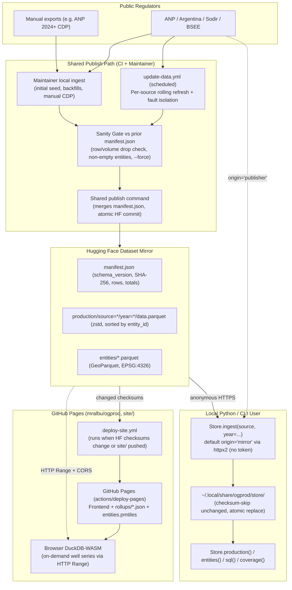

# Data mirror, ingestion pipeline, and static-site distribution — design

Status: approved 2026-11-22 (design interview); ready for Milestone 1
implementation.

## Goal

Give `ogprod` a fast, reliable, zero-auth distribution layer for prebuilt
canonical Parquet data — serving both **local Python/CLI users** and a
**GitHub Pages data visualization** — without committing binary data to git
or hammering flaky regulator portals on every install or site rebuild.

Also migrate the HTTP client from the unmaintained `httpx` package to
Pydantic's maintained fork, [`httpx2`](https://github.com/pydantic/httpx2).

## Why not a git branch in this repo

Keeping scraped data on an orphan branch works for small text datasets
(< 20–50 MB), but breaks down for `ogprod`:

- **Scale:** Argentina's 20-year history alone is ~150 MB of zstd Parquet
  (measured in `2026-10-08-store-centric-api-design.md`). With ANP
  (1941–2023), BSEE, and future well-level sources (Petrinex, Texas RRC),
  the full store grows from ~300 MB to **1–3+ GB**, pushing past GitHub's
  soft repo limit (~1–5 GB) and risking the 100 MB/file hard limit.
- **Binary history bloat:** Parquet files cannot be delta-compressed by git.
  Every monthly rewrite of an active year partition appends a full binary
  blob to git history, bloating clones for developers and CI.
- **Git LFS quota:** GitHub's free LFS tier is 1 GB storage and 1 GB/month
  bandwidth — unusable for public dataset distribution.

## Three data tiers

Keeping the three artifacts separate matches each one's size, update cadence,
and consumers:

1. **Archival raw publisher drops** *(immutable, only when regulators delete
   history, e.g. ANP 1941–2004)* → **Zenodo** (see
   [2026-10-07-anp-historical-zenodo-mirror-design.md](2026-10-07-anp-historical-zenodo-mirror-design.md)).
2. **Canonical Parquet mirror** *(the `ogprod.Store` hive tree +
   `manifest.json`)* → **Hugging Face Dataset repo** (50 GB+ free, unlimited
   egress, exact hive directory tree, HTTP Range + CORS for browser
   DuckDB-WASM, git-backed revisions/tags).
3. **Derived static-site assets** *(rollups JSON + `entities.pmtiles`)* →
   **GitHub Pages** deployed directly via `actions/upload-pages-artifact` +
   `actions/deploy-pages` (no `gh-pages` branch, zero binary files in git),
   paired with on-demand browser DuckDB-WASM queries against the HF Parquet
   mirror for individual well drill-down.

## End-to-end flow



## Decisions (user-approved)

1. **Default `origin="mirror"` for `Store.ingest`.** Local users pull
   prebuilt Parquet from Hugging Face over anonymous HTTPS using `httpx2` —
   no HF account/token and no `huggingface_hub` runtime dependency.
   `origin="publisher"` fetches live directly from regulator portals.
2. **Checksum-skip + atomic partition replace.** On `origin="mirror"`,
   partitions whose local SHA-256 matches `manifest.json` are skipped;
   otherwise the mirror Parquet is downloaded, SHA-256 verified, and
   atomically swapped over the `(source, year)` partition (same for
   `entities/<source>.parquet`). Mirror is authoritative when
   `origin="mirror"`.
3. **Strictly local-first `Store`.** Keep "one way in, one way out":
   `Store.production()`, `entities()`, and `sql()` read only local disk.
   Direct DuckDB-over-HF URL queries are documented as a power-user recipe
   rather than adding a remote-read mode to `Store`.
4. **Single HF Dataset repo mirroring the exact `Store` layout.**
   `production/source=<src>/year=<YYYY>/data.parquet`,
   `entities/<src>.parquet`, and `manifest.json` on `main`, with optional
   monthly git tags (e.g. `2026-11`) for reproducible pinning via
   `revision=`.
5. **Mirror ingest options.** For `origin="mirror"`, accept `year=` (`int`,
   iterable of `int`, or `None` for all mirrored years) and
   `revision="main"`. Reject `month=` with a clear `TypeError` directing the
   caller to `origin="publisher"` (mirror partitions are yearly).
6. **Scheduled CI refresh with per-source fault isolation.**
   `update-data.yml` refreshes active sources on rolling windows (Sodir full,
   Argentina/BSEE current + previous year, static sources skipped). A
   failing regulator portal never blocks healthy sources from publishing.
7. **Publish sanity gate.** Before pushing to HF, compare each candidate
   partition's row count and per-product volume totals against the prior
   `manifest.json` entry; reject unexpected drops beyond a threshold and
   reject empty entity files. Support `--force` for intentional corrections.
8. **One shared publish path (CI + maintainer laptop).** Both
   `update-data.yml` (using `secrets.HF_TOKEN`) and the maintainer locally
   (for initial full-history seeds, backfills, and manual exports like ANP
   2024+ CDP) run the same publish command. It always merges into
   `manifest.json` via an atomic HF commit without deleting untouched
   partitions.
9. **Hybrid GitHub Pages architecture in this repo (`site/`).** GitHub Pages
   serves the frontend, pre-aggregated `rollups/*.json`, and
   `entities.pmtiles` (instant initial map and country/basin/field charts,
   tiny deploy artifact). Individual well drill-down uses browser
   DuckDB-WASM querying HF Parquet directly via HTTP Range + CORS.
   `update-data.yml` triggers `deploy-site.yml` only when mirror checksums
   change.
10. **HTTP client: `httpx2`.** Replace `httpx` with Pydantic's `httpx2` fork
    (`import httpx2`) across the package, tests, and docs.

---

## Milestone 1 — Mirror, Manifest, Publish Pipeline & `httpx2`

Everything in this section is specified for immediate implementation.

### 1. Migrate `httpx` → `httpx2`

- **`pyproject.toml`:** replace `"httpx>=0.27"` with `"httpx2>=2.0"`.
- **Imports and types:** rename `import httpx` → `import httpx2` and
  `httpx.*` → `httpx2.*` across `src/ogprod/sources/{base,anp,argentina,sodir}.py`,
  `src/ogprod/store.py`, and `tests/{test_fetch,test_ingest,test_sources_sodir}.py`.
- **Docs:** update `CLAUDE.md`, `docs/design.md`, `docs/downloading.md`.
- **Notable behavior improvement:** `httpx2` verifies TLS against the OS
  trust store (`truststore`) rather than a bundled CA list, improving
  corporate-proxy compatibility. The public API (`Client`, `Timeout`, `URL`,
  `MockTransport`, `Request`, `Response`) is identical.
- **Compatibility note:** callers injecting a custom `client=` must pass an
  `httpx2.Client` (acceptable pre-1.0, and `ogprod` is bumping on v2).

### 2. Parquet encoding & row-group tuning (`src/ogprod/store.py`)

Update `_atomic_write_parquet` so every newly written store file is already
optimal for both the mirror and browser DuckDB-WASM HTTP Range reads:

- **Compression:** `compression="zstd"` (saves 20–25% losslessly vs snappy;
  float64 stays unchanged for exact cross-checks).
- **Row-group size (production):** `row_group_size=128_000` (via pyarrow /
  `to_parquet(..., compression="zstd", row_group_size=128_000)`).
  `write_production` already sorts every partition by
  `("entity_id", "period", "product", "field")`, so bounded row groups give
  tight per-group min/max `entity_id` statistics — allowing DuckDB-WASM to
  read a single well's series over HTTP Range in tens of kilobytes instead
  of fetching the full year file.
- **Entities GeoParquet:** `compression="zstd"` (single small file per
  source; `row_group_size` default is fine).
- **Backwards compatibility:** existing snappy Parquet files in local stores
  remain fully readable by pandas/DuckDB.

### 3. Mirror layout & `manifest.json` schema

The Hugging Face Dataset repo (default `mralbu/ogprod`, overridable via
`$OGPROD_MIRROR` or `mirror=` parameter) holds:

```text
README.md                                          # HF dataset card + source licences/attribution
manifest.json                                      # single index of all mirrored files + stats
production/source=anp/year=2005/data.parquet
...
production/source=argentina/year=2026/data.parquet
production/source=sodir/year=1971/data.parquet
entities/anp.parquet
entities/argentina.parquet
entities/sodir.parquet
```

File URLs resolve with plain HTTPS (no HF SDK required for readers):

```text
https://huggingface.co/datasets/{repo}/resolve/{revision}/{relative_path}
```

`manifest.json` structure (schema version `1`):

```json
{
  "schema_version": 1,
  "updated_at": "2026-11-22T12:00:00Z",
  "sources": {
    "anp": {
      "production": {
        "2023": {
          "path": "production/source=anp/year=2023/data.parquet",
          "sha256": "<hex>",
          "bytes": 4123456,
          "rows": 312450,
          "first_period": "2023-01-01",
          "last_period": "2023-12-01",
          "totals_m3": {
            "oil": 195123456.7,
            "gas": 54123456789.0,
            "condensate": 3123456.8,
            "water": 210456789.1
          },
          "updated_at": "2026-11-22T12:00:00Z"
        }
      },
      "entities": {
        "path": "entities/anp.parquet",
        "sha256": "<hex>",
        "bytes": 1823456,
        "rows": 31273,
        "updated_at": "2026-11-22T12:00:00Z"
      }
    }
  }
}
```

Design rules for `manifest.json`:

- **`schema_version`** is an integer (`1`). Readers check
  `manifest["schema_version"] <= SUPPORTED_SCHEMA_VERSION`; a higher version
  raises a clear `RuntimeError` asking the user to upgrade `ogprod`.
- **Canonical paths** are relative POSIX paths identical to the local store
  layout. Readers validate paths stay inside the store root (no `..` or
  absolute paths).
- **`totals_m3`** records exact float64 sums per product per partition,
  enabling fast sanity-gate checks on publish without re-downloading old
  partitions.
- **No local manifest required for reads:** `Store.coverage()` continues to
  compute directly from local Parquet files, and checksum-skipping hashes
  the local target file directly (fast: SHA-256 of a 10 MB file is ~15 ms).

### 4. Local mirror ingest (`Store.ingest` & CLI)

Updated `Store.ingest` signature:

```python
def ingest(
    self,
    source: str,
    *,
    origin: Literal["mirror", "publisher"] = "mirror",
    revision: str = "main",
    mirror: str | None = None,
    files: Sequence[str | Path] | None = None,
    entities: bool = True,
    refresh: bool = False,
    client: httpx2.Client | None = None,
    **options: Any,
) -> IngestResult:
```

Behavior rules:

- **Origin validation:**
  - `origin` must be `"mirror"` or `"publisher"` (else `ValueError`).
  - When `files is not None`: ingest runs from those local files (unchanged
    from today). Passing `options` raises `TypeError`; passing non-default
    `revision` or `mirror` raises `TypeError`.
  - When `origin == "publisher"`: behaves identically to today's `ingest`
    (downloads via `connector.fetch` / `fetch_entities`, parses in
    `restatement_order`, batches, upserts). Passing non-default `revision`
    or `mirror` raises `TypeError`.
- **When `origin == "mirror"` (`files is None`):**
  - Unknown `options` raise `TypeError`. Specifically:
    - `year=` is accepted as `int`, `Iterable[int]`, or `None` (all years
      available for `source` in `manifest.json`).
    - `month=` raises `TypeError` with a clear message: *"mirror partitions
      are yearly; omit `month` or pass `origin='publisher'`"*.
  - Validates `source` exists in `ogprod.available()` (and in the remote
    `manifest.json`; if registered locally but not yet on the mirror, raises
    `KeyError` / `ValueError` suggesting `origin="publisher"`).
  - Fetches `manifest.json` once from `{mirror_base}/resolve/{revision}/manifest.json`
    using `base.open_client(client)` (plain `httpx2`, `follow_redirects=True`).
  - Resolves requested years against `manifest["sources"][source]["production"]`.
    If an explicitly requested year is missing from the mirror, raises
    `ValueError` naming the missing year(s) and available span (and
    suggesting `origin="publisher"`).
  - For each target `(source, year)` partition:
    1. If local `data.parquet` exists and its SHA-256 equals the manifest
       `sha256`, **skip** download (no rewrite).
    2. Otherwise stream download to `data.parquet.tmp`, hashing on the fly.
    3. Verify `bytes` and `sha256` against the manifest. On mismatch, delete
       `.tmp` and raise `RuntimeError` (never leaving corrupt bytes).
    4. Atomically `os.replace(tmp, target)` and append `target` to `written`.
  - **Entities (mirror):**
    - When `entities=True` and `source` has an `entities` entry in
      `manifest.json`, apply the same checksum-skip rule as production
      partitions: if local `entities/<source>.parquet` already matches the
      manifest `sha256` (and `refresh=False`), skip the download
      (`IngestResult.entities is None`); otherwise download, verify
      `bytes`/`sha256`, and atomically replace. (If `refresh=True`, force
      re-download even on checksum match; if the manifest has no `entities`
      entry for `source`, `IngestResult.entities` is `None`.)
  - **Failure mid-run:** identical to publisher ingest — partitions already
    placed stay on disk and the exception gets a note listing them; re-running
    skips already-verified partitions and resumes cleanly.
  - **`IngestResult`:** keeps the same fields (`source`, `rows`,
    `first_period`, `last_period`, `partitions`, `entities`) — for mirror
    ingests, `rows`, `first_period`, `last_period`, and `entities` come from
    the manifest entries of the synced selection, while `partitions` lists
    only the partition files actually written/updated (so a no-op re-run
    reports `0 partition(s)` updated).

**Mirror URL resolution** (`resolve_mirror(mirror=None)`):

1. Explicit `mirror=` argument (accepts either a Hugging Face repo id like
   `"mralbu/ogprod"` or a full base URL for testing/custom mirrors).
2. `$OGPROD_MIRROR` environment variable.
3. Default constant `DEFAULT_MIRROR = "mralbu/ogprod"`.

**CLI updates (`src/ogprod/__main__.py`):**

- `python -m ogprod ingest <source>` gains:
  - `--origin {mirror,publisher}` (default: `mirror`)
  - `--revision REV` (default: `main`)
  - `--mirror REPO_OR_URL` (optional override)
  - `--year` may be repeated or remain single int (supporting `nargs="+"` or
    repeated `--year` for mirror multi-year pulls; keep single `--year 2023`
    compatible).
- `just ingest` passes all flags through unchanged.

**Notebooks & docs impact:**

- `README.md` quickstart becomes instant (`db.ingest("anp", year=2023)` pulls
  from mirror in seconds).
- Notebooks 01 & 03 can use default `origin="mirror"` (fast, reliable
  re-execution); Notebook 02's raw terra/mar/pré-sal comparison continues to
  fetch raw CSVs and ingest via `files=`.

### 5. Shared publish tool & sanity gate

Create a reusable publish module (`src/ogprod/mirror.py` for shared
manifest/checksum helpers, plus a maintainer CLI entrypoint
`scripts/publish_mirror.py` — or `python -m ogprod.mirror publish` — using
`huggingface-hub` placed in a `[dependency-groups]` `publish` group so end
users never install it).

**Command interface (identical in CI and locally):**

```bash
uv run --group publish python scripts/publish_mirror.py \
    --store /path/to/store \
    --source sodir --source argentina \
    --year 2025 --year 2026 \        # optional filter; omit to inspect all partitions of --source
    --repo mralbu/ogprod \           # default: $OGPROD_MIRROR or DEFAULT_MIRROR
    --force \                        # bypass sanity-gate drop thresholds
    --dry-run \                      # print planned diff & gate results, push nothing
    --tag 2026-11                    # optional git tag on HF after commit
```

**Execution steps:**

1. Authenticate via `HF_TOKEN` env var (fail fast if missing unless
   `--dry-run`).
2. Fetch remote `manifest.json` and the current `main` commit OID from HF
   (if the repo is brand new and has no `manifest.json`, start from an empty
   schema v1 manifest).
3. Inspect selected local `(source, year)` partitions and
   `entities/<source>.parquet`:
   - Compute `sha256`, `bytes`, `rows`, `first_period`, `last_period`, and
     per-product `totals_m3` directly via DuckDB/pyarrow.
   - Skip any file whose `sha256` already matches the remote `manifest.json`
     (no-op).
4. **Sanity gate** (for every changed file, unless `--force`):
   - Reject empty production partitions (`rows == 0`) and empty entity files
     (`rows == 0`).
   - If the partition already exists in the remote `manifest.json`:
     - Reject if `new_rows < 0.85 * old_rows` (more than 15% row-count drop).
     - Reject if any product's `totals_m3` in the old manifest drops by more
       than 15% (guarding against truncated downloads or broken column
       mappings).
   - If the entities file already exists in the remote `manifest.json`:
     - Reject if `new_rows < 0.90 * old_rows`.
   - Print a concise diff table (old vs new rows and totals per partition)
     so CI logs and local dry-runs are auditable.
5. **Merge & atomic commit:**
   - Merge only the changed entries into a copy of the remote `manifest.json`
     — **never delete or alter untouched sources/years** (so manual ANP
     2024+ CDP uploads or historical backfills survive scheduled CI runs).
   - Bump top-level `updated_at`.
   - Upload changed Parquet files + updated `manifest.json` in a single
     atomic `HfApi.create_commit(..., parent_commit=remote_oid)` call. Passing
     `parent_commit` prevents a concurrent local push and CI run from
     silently overwriting each other's `manifest.json`.
   - If `--tag` is given, create the git tag on the new commit.
   - Write `changed=true` or `changed=false` to `$GITHUB_OUTPUT` when running
     in GitHub Actions.

### 6. Scheduled CI workflow (`.github/workflows/update-data.yml`)

- **Triggers:**
  - `schedule`: weekly (e.g. Mondays `08:00 UTC`, after `smoke.yml`).
  - `workflow_dispatch`: optional inputs `sources` (comma-separated, default
    all active), `years` (optional override for backfills), `force` (bool),
    `tag` (optional monthly tag).
- **Concurrency:** `group: mirror-publish`, `cancel-in-progress: false` (one
  writer to the HF mirror at a time).
- **Per-source rolling refresh policy** (in a small config dict in the CI
  driver script, e.g. `scripts/ci_refresh.py`):
  - `sodir`: full table (single ~2 MB CSV) + entities.
  - `argentina`: `[current_year, current_year - 1]` + entities.
  - `bsee` *(once added)*: `[current_year, current_year - 1]` + entities.
  - `anp`: skipped on schedule (bulk archive freezes at 2023; updated
    manually or via `workflow_dispatch` until 2024+ CDP automation exists).
- **Fault isolation:**
  - Each source ingests into an isolated local store root (or per-source
    try/except around `Store.ingest(..., origin="publisher", refresh=True)`).
  - All sources that succeed are passed together to `publish_mirror.py`.
  - If any source failed to ingest or failed the sanity gate, publish the
    healthy sources first, then exit non-zero at the end of the job so
    GitHub alerts the maintainer without stalling other regulators.
- **Chaining to GitHub Pages (Milestone 2):**
  - If `publish_mirror.py` reports `changed=true`, trigger `deploy-site.yml`
    (via `workflow_run` or `workflow_dispatch` / reusable workflow).

### 7. Testing plan (Milestone 1)

- **Mirror read tests (`tests/test_mirror.py`):**
  - All HTTP served by `httpx2.MockTransport` (zero network).
  - Full source sync + selective `year=` (int and list) + `revision=` URL
    routing.
  - Checksum skip: second `ingest` makes only the `manifest.json` request
    and writes 0 partitions.
  - Updated manifest SHA-256 replaces the local partition atomically.
  - Corrupted download (SHA-256 or byte-length mismatch) deletes `.tmp`,
    leaves any prior local file intact, and raises.
  - Unsupported `schema_version > 1` fails with a clear upgrade error.
  - Path traversal in a hostile `manifest.json` (`../escape.parquet`) is
    rejected.
  - `month=` with `origin="mirror"` raises `TypeError` mentioning
    `origin="publisher"`.
  - Missing requested year raises `ValueError` listing available years.
  - `files=` combined with `revision=`/`mirror=` raises `TypeError`.
  - Mid-run failure on partition 2 leaves partition 1 on disk and attaches
    the flushed-partitions exception note.
- **Publish & sanity-gate tests (`tests/test_publish_mirror.py`):**
  - Pure tests against a local tmp store + fake prior manifest + mocked
    `HfApi`.
  - Untouched sources/years in remote `manifest.json` are preserved verbatim.
  - Byte-identical partitions produce a no-op (`changed=False`, no commit).
  - >15% row or product-total drop fails the gate; `--force` overrides it.
  - Empty entity file fails the gate.
- **Parquet tuning test (`tests/test_store.py`):**
  - Assert written production Parquet uses `ZSTD` compression and respects
    bounded row groups.
- **`httpx2` migration:** existing suite (`ruff`, `ty`, `pytest`) and
  `pytest -m live` pass cleanly on `httpx2`.

---

## Milestone 2 — Site Exporter & GitHub Pages (`site/`) *(outline)*

Detailed frontend/exporter design gets its own spec after Milestone 1 ships.
Architectural boundaries already agreed:

- **Location:** `site/` inside `mralbu/ogprod` + an exporter module
  (`ogprod export-site` / `scripts/export_site.py`).
- **Hybrid data serving:**
  - **On GitHub Pages (`dist/data/`):**
    - `rollups/*.json` — pre-aggregated country, basin, and field × product ×
      month time series (~1–5 MB; powers instant dashboards and field charts).
    - `entities.pmtiles` — single vector tile archive built from
      `entities/*.parquet` (well points clustered at low zoom + field ring
      fence polygons, ~5–30 MB; served same-origin with HTTP Range requests).
    - `meta.json` — copied/trimmed from HF `manifest.json` (data freshness
      timestamps, source attributions, mirror URL + pinned revision/commit).
  - **Direct from Hugging Face (browser DuckDB-WASM):**
    - Individual well click-to-chart series and optional ad-hoc SQL/CSV
      downloads query the zstd `entity_id`-sorted Parquet partitions on HF
      directly via HTTP Range + CORS.
- **Deployment (`.github/workflows/deploy-site.yml`):**
  - Triggered on `push` to `main` touching `site/` or exporter code, on
    `workflow_dispatch`, and when `update-data.yml` publishes new mirror
    checksums.
  - Pulls the mirror via `ogprod ingest` (default `origin="mirror"`), runs
    the exporter, builds `site/`, and deploys with
    `actions/upload-pages-artifact` + `actions/deploy-pages` (no `gh-pages`
    branch).
- **Deferred to Milestone 2 spec:** PMTiles build tool in CI (`tippecanoe`
  vs pure Python), frontend stack/charting library, exact rollup JSON
  schema, and UI design.

---

## Maintainer prerequisites (before first seed)

1. Create the public Hugging Face Dataset repository (e.g. `mralbu/ogprod`)
   with a dataset card documenting provenance and per-source licences (ANP
   CC-BY 4.0, Argentina CC-BY 4.0, Sodir NLOD, BSEE US public domain).
2. Create a write-scoped HF access token and add it as `HF_TOKEN` in the
   `mralbu/ogprod` GitHub repository's Actions secrets.
3. Run the initial full-history seed locally (`ogprod ingest --origin publisher`
   for Sodir, ANP 2005–2023, Argentina history) and push with
   `scripts/publish_mirror.py`.
